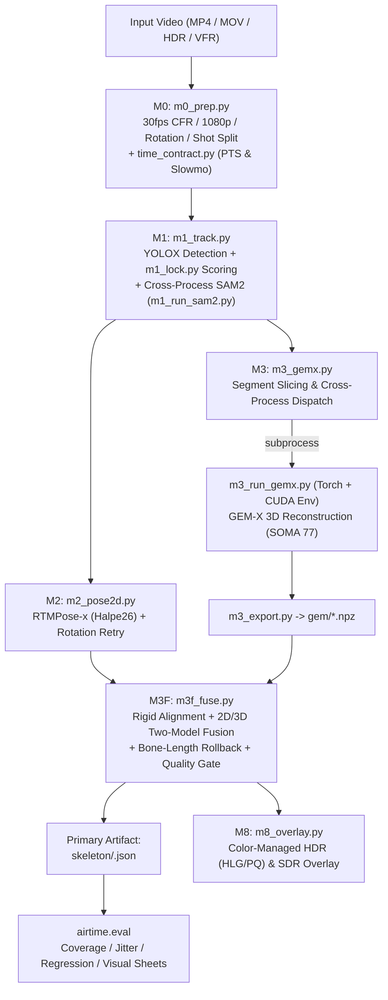

# Airtime System Architecture

Airtime reconstructs frame-accurate 3D human skeletons for freestyle skiing from monocular videos via a deterministic, modular, multi-stage pipeline with process-level dependency isolation.

---

## 1. End-to-End Pipeline

---

## 2. Process & Environment Isolation

Airtime intentionally separates lightweight 2D/post-processing workloads from heavy PyTorch + CUDA 3D/segmentation workloads:

| Runtime Environment | Modules | Key Dependencies |
|---|---|---|
| **Main Environment** (`.venv`) | `run.py`, `cfg.py`, `eval.py`, `time_contract.py`, `m0_prep.py`, `m1_track.py`, `m2_pose2d.py`, `m3_gemx.py`, `m3f_fuse.py`, `m8_overlay.py` | `numpy`, `opencv-python`, `onnxruntime-gpu`, `rtmlib`, `ffmpeg` |
| **Torch/CUDA Subprocess** (`AIRTIME_GEMX_PYTHON` / `AIRTIME_SAM2_PYTHON`) | `m1_run_sam2.py`, `m3_run_gemx.py` | `torch` + CUDA, `GEM-X`, `SAM2` |

This design prevents ABI and CUDA/PyTorch version conflicts while allowing `airtime` to run on lightweight environments (see [ADR-001](adr/001-cross-process-torch-isolation.md)).

---

## 3. Core Subsystems

### 3.1 Configuration & Path Resolution (`src/airtime/cfg.py`)
- Zero hardcoded absolute paths in code.
- Resolution order: Environment variables (`AIRTIME_*`) → repository defaults (`configs/`, `models/`, `data/`, `runs/`).
- All algorithmic thresholds are centralized in `configs/pipeline.json`; visual tokens live in `configs/style.json`; SOMA 77 joint definitions live in `configs/joint_names.json`.

### 3.2 Time Contract (`src/airtime/time_contract.py`)
- Extracts frame-level PTS and detects variable frame rate (VFR) before 30 fps CFR normalization.
- Maps every normalized frame `k` back to `(source_frame_idx, source_pts_s)`.
- Strictly separates `playback_time_s` from `real_time_s`; `real_time_s` is populated only when `slowmo_factor` is explicitly confirmed, preventing invalid physical calculations on slow-motion footage.

### 3.3 Activity-Driven Target Locking (`src/airtime/m1_lock.py`)
- Ranks candidate tracks primarily on skiing motion features (speed, vertical acceleration/airtime, trajectory span) rather than static screen duration.
- Applies geometric quality penalties for clipped frame edges, invalid aspect ratios, short tracks, and abrupt box-size jumps.
- Supports optional `target_hint` overrides without any hardcoded video-ID branches.

### 3.4 Deterministic Execution (`src/airtime/det_deterministic.py`)
- Patches `onnxruntime.InferenceSession` to enforce `cudnn_conv_algo_search=HEURISTIC` on `CUDAExecutionProvider` (see [ADR-002](adr/002-deterministic-onnxruntime.md)).
- Ensures cross-process bit-identical boxes and 2D keypoints across repeated runs.

### 3.5 Evaluation & Regression Guard (`src/airtime/eval.py`)
- Computes per-video and aggregate coverage, 2nd-order acceleration jitter (`p50`/`p95` normalized by `box_h`), fusion ratio, bone-rollback count, bad projection count, and stage runtimes.
- Generates Markdown/JSON before-vs-after regression reports and side-by-side visual comparison contact sheets.
